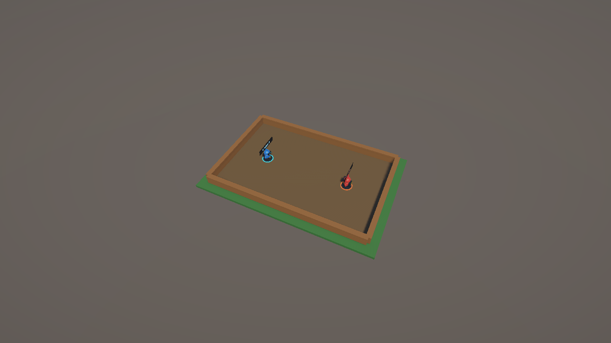
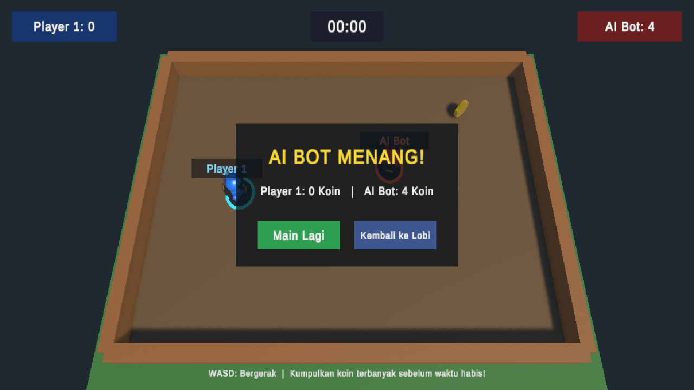

# LAPORAN TUGAS AKHIR
**PRAKTIKUM PEMROGRAMAN GAME BERBASIS JARINGAN**

**Oleh:**  
Nama Lengkap  
NRP.  

**PROGRAM STUDI SARJANA TERAPAN TEKNOLOGI GAME**  
**JURUSAN TEKNOLOGI MULTIMEDIA KREATIF**  
**POLITEKNIK ELEKTRONIKA NEGERI SURABAYA**  
**2026**

---

## Judul Game
**Coin Rush 2P** *(Dokumen 1 — Fase 1: Prototipe Inti Offline & Lawan AI)*

## Ringkasan
**Coin Rush 2P** adalah gim *3D top-down arcade* kompetitif di atas sepetak arena tanah berpagar. Pada fase pertama ini dibangun dua fitur inti:
1. **Kontrol `WASD` dengan Unity New Input System:** Menggerakkan karakter pemain di bidang datar *top-down* secara responsif.
2. **Spawning Koin, Timer & Lawan AI:** Sistem pemunculan koin acak dengan batas waktu ronde 60 detik melawan *AI Bot* pengumpul koin untuk pengujian mekanik inti.

## Pengendalian dan Mekanisme
- **Aturan Tombol:**
  - `W` / `A` / `S` / `D` — Menggerakkan karakter ke atas, kiri, bawah, dan kanan (`Player/Move` pada `InputSystem_Actions.inputactions`).
  - **Klik Mouse (UI)** — Menekan tombol **Main Lagi** saat ronde berakhir.
- **Cara Kerja & Prosedur:**
  1. Saat ronde dimulai, sistem menjalankan hitung mundur singkat (`3, 2, 1, GO!`) sebelum kendali dibuka.
  2. Pemain (`WASD`) dan **AI Bot** berlomba menyentuh koin emas yang muncul acak di arena untuk memperoleh `+1` poin per koin.
  3. Ketika batas waktu 60 detik habis (`00:00`), pergerakan dikunci dan sistem membandingkan skor; peraih koin terbanyak dinyatakan menang.

## Tangkapan Layar Tahapan Pembuatan



**Gambar 1. Tampilan *Scene View* Arena 3D Top-Down (`CoinRush.unity`).**  
Menunjukkan pembangunan area permainan berupa sepetak tanah datar berukuran `16 x 10` unit yang dikelilingi 4 dinding pagar pembatas serta penempatan awal aktor pemain dan lawan sebelum pengujian.

## Tangkapan Layar Hasil



**Gambar 2. Tampilan Hasil Akhir Pertandingan (`ResultPanel`).**  
Menunjukkan kondisi setelah batas waktu 60 detik berakhir (`00:00`), lengkap dengan pengumuman pemenang, perbandingan jumlah koin kedua kubu, dan tombol **Main Lagi**.

## Kode Program

### 1. `PlayerInputProvider.cs` (Kontrol `WASD` via New Input System)
```csharp
using UnityEngine;
using UnityEngine.InputSystem;

namespace CoinRush.Player
{
    public class PlayerInputProvider : MonoBehaviour, IInputProvider
    {
        [SerializeField] private InputActionReference moveAction;

        private InputAction _runtimeFallbackAction;
        private InputAction _activeAction;

        private void Awake()
        {
            if (moveAction != null && moveAction.action != null)
            {
                _activeAction = moveAction.action;
            }
            else
            {
                _runtimeFallbackAction = new InputAction("Move", InputActionType.Value, expectedControlType: "Vector2");
                _runtimeFallbackAction.AddCompositeBinding("2DVector")
                    .With("Up", "<Keyboard>/w")
                    .With("Down", "<Keyboard>/s")
                    .With("Left", "<Keyboard>/a")
                    .With("Right", "<Keyboard>/d");
                _activeAction = _runtimeFallbackAction;
            }
        }

        private void OnEnable()
        {
            if (_runtimeFallbackAction != null)
            {
                _runtimeFallbackAction.Enable();
            }
            else if (moveAction != null && moveAction.action != null && !moveAction.action.enabled)
            {
                moveAction.action.Enable();
            }
        }

        private void OnDisable()
        {
            _runtimeFallbackAction?.Disable();
        }

        private void OnDestroy()
        {
            _runtimeFallbackAction?.Dispose();
        }

        public Vector2 GetMoveInput()
        {
            if (!enabled || _activeAction == null)
            {
                return Vector2.zero;
            }
            return _activeAction.ReadValue<Vector2>();
        }
    }
}
```

### 2. `GameManager.cs` (Alur Ronde, Timer & Penentuan Pemenang)
```csharp
using System.Collections;
using Unity.Netcode;
using UnityEngine;
using CoinRush.Audio;
using CoinRush.Gameplay;
using CoinRush.Player;
using CoinRush.UI;

namespace CoinRush.Core
{
    public enum MatchState { Countdown, Playing, GameOver }

    public class GameManager : MonoBehaviour
    {
        public static GameManager Instance { get; private set; }

        [SerializeField] private float roundDuration = 60f;
        [SerializeField] private int countdownSeconds = 3;
        [SerializeField] private int initialCoinCount = 3;

        [SerializeField] private PlayerAgent player1;
        [SerializeField] private PlayerAgent player2;
        [SerializeField] private CoinSpawner coinSpawner;
        [SerializeField] private GameHUD hud;

        [SerializeField] private Vector3 player1SpawnPos = new Vector3(-4.5f, 0.55f, 0f);
        [SerializeField] private Vector3 player2SpawnPos = new Vector3(4.5f, 0.55f, 0f);

        private MatchState _state = MatchState.Countdown;
        private int _player1Score;
        private int _player2Score;
        private float _remainingTime;
        private Coroutine _matchFlowRoutine;

        public MatchState State => _state;
        public int Player1Score => _player1Score;
        public int Player2Score => _player2Score;
        public float RemainingTime => _remainingTime;

        private void Awake()
        {
            if (Instance != null && Instance != this) { Destroy(gameObject); return; }
            Instance = this;
        }

        private void Start()
        {
            if (NetworkManager.Singleton != null && NetworkManager.Singleton.IsListening)
            {
                if (player1 != null) player1.gameObject.SetActive(false);
                if (player2 != null) player2.gameObject.SetActive(false);
                return;
            }

            coinSpawner?.SetTrackedActors(player1?.transform, player2?.transform);
            hud?.Bind(this);
            StartMatch();
        }

        public void StartMatch()
        {
            if (_matchFlowRoutine != null) StopCoroutine(_matchFlowRoutine);
            _player1Score = 0;
            _player2Score = 0;
            _remainingTime = roundDuration;
            _state = MatchState.Countdown;

            coinSpawner?.StopSpawning();
            coinSpawner?.ClearAllCoins();
            player1?.ResetForMatch(player1SpawnPos, Quaternion.LookRotation(Vector3.right, Vector3.up));
            player2?.ResetForMatch(player2SpawnPos, Quaternion.LookRotation(Vector3.left, Vector3.up));

            hud?.UpdateScores(_player1Score, _player2Score, "Player 1", "AI Bot");
            hud?.UpdateTimer(_remainingTime);
            hud?.HideResult();

            _matchFlowRoutine = StartCoroutine(RunMatchRoutine());
        }

        public void NotifyCoinCollected(int playerIndex, int amount, Vector3 worldPosition)
        {
            if (_state != MatchState.Playing) return;
            if (playerIndex == 0) _player1Score += amount;
            else _player2Score += amount;
            hud?.UpdateScores(_player1Score, _player2Score, "Player 1", "AI Bot");
        }

        private IEnumerator RunMatchRoutine()
        {
            for (int sec = countdownSeconds; sec > 0; sec--)
            {
                hud?.ShowCountdown(sec.ToString());
                yield return new WaitForSeconds(1f);
            }

            hud?.ShowCountdown("GO!");
            _state = MatchState.Playing;
            player1?.SetControlActive(true);
            player2?.SetControlActive(true);
            coinSpawner?.BeginSpawning(initialCoinCount);

            float goTimer = 0.6f;
            while (_remainingTime > 0f)
            {
                _remainingTime = Mathf.Max(0f, _remainingTime - Time.deltaTime);
                if (goTimer > 0f && (goTimer -= Time.deltaTime) <= 0f) hud?.HideCountdown();
                hud?.UpdateTimer(_remainingTime);
                yield return null;
            }

            EndMatch();
        }

        private void EndMatch()
        {
            _state = MatchState.GameOver;
            player1?.SetControlActive(false);
            player2?.SetControlActive(false);
            coinSpawner?.StopSpawning();

            string headline = _player1Score > _player2Score
                ? "PLAYER 1 MENANG!"
                : (_player2Score > _player1Score ? "AI BOT MENANG!" : "SERI!");
            hud?.HideCountdown();
            hud?.ShowResult(headline, "Player 1", _player1Score, "AI Bot", _player2Score);
        }
    }
}
```
