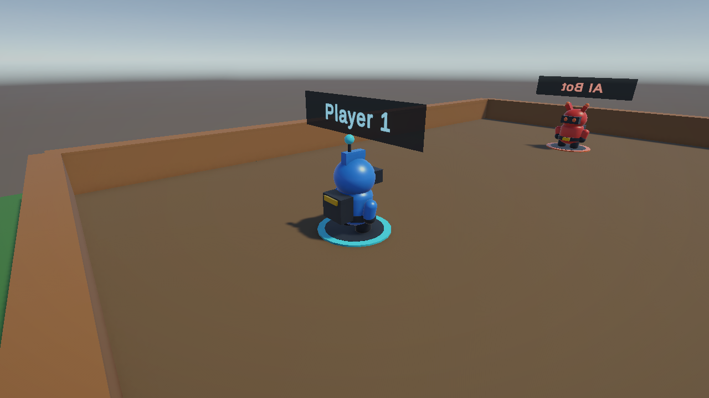
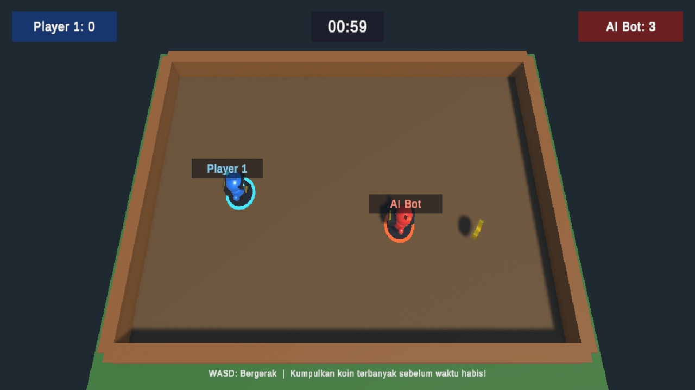

# LAPORAN TUGAS AKHIR
**PRAKTIKUM PEMROGRAMAN GAME BERBASIS JARINGAN**

**Oleh:**  
Nama Lengkap  
NRP.  

**PROGRAM STUDI SARJANA TERAPAN TEKNOLOGI GAME**  
**JURUSAN TEKNOLOGI MULTIMEDIA KREATIF**  
**POLITEKNIK ELEKTRONIKA NEGERI SURABAYA**  
**2026**

---

## Judul Game
**Coin Rush 2P** *(Dokumen 2 — Fase 2: Audio Synthesizer Prosedural & Identitas Karakter)*

## Ringkasan
Pada fase kedua, gim **Coin Rush 2P** ditingkatkan melalui dua fitur utama untuk memperkuat *game feel* dan keterbacaan visual dari kamera *top-down*:
1. **Synthesizer SFX Elektronik Prosedural:** Pembangkitan efek suara langsung di dalam kode (`AudioClip.Create`) tanpa aset audio eksternal.
2. **Pembaruan Model Karakter 3D Beridentitas:** Penambahan cincin tim menyala, ransel koin, siluet mahkota berbeda antara pemain dan lawan, *name tag*, serta animasi lari prosedural.

## Pengendalian dan Mekanisme
- **Aturan Tombol:** Tetap menggunakan `W / A / S / D` (New Input System) untuk menggerakkan karakter dan mouse untuk tombol UI.
- **Cara Kerja & Mekanisme Fitur:**
  1. **Feedback Audio Mekanik (`SynthAudioManager`):** Saat gim dimulai, sistem mensintesis gelombang elektronik (`Sine`, `Triangle`, `SoftSquare`, `SawSoft`) pada `44100 Hz` untuk bunyi pengambilan koin, *countdown*, `GO!`, detak 10 detik terakhir, tabrakan fisik, dan fanfare kemenangan.
  2. **Identitas & Animasi Karakter (`CharacterVisualController`):** Mengubah warna & bentuk mahkota sesuai slot (antena *commander* biru untuk Player 1, tanduk kembar merah untuk AI/Player 2), menggerakkan ayunan tangan dan pantulan lari dari perpindahan posisi, serta mengarahkan *name tag* selalu menghadap kamera.

## Tangkapan Layar Tahapan Pembuatan



**Gambar 1. Perakitan Model Karakter 3D pada *Scene View*.**  
Menunjukkan detail karakter baru berupa cincin tim menyala di lantai, ransel koin beraksen emas, antena *commander* pada Player 1 (biru), tanduk kembar dan visor menyala pada AI Bot (merah), serta *name tag* di atas kepala.

## Tangkapan Layar Hasil



**Gambar 2. Hasil Gameplay dengan Karakter Beridentitas dan Feedback Audio.**  
Menunjukkan kedua karakter saling beradu cepat mengumpulkan koin di arena dengan cincin tim, tag nama yang jelas, serta pembaruan skor HUD yang disertai umpan balik SFX synthesizer saat koin diambil.

## Kode Program

### 1. `SynthAudioManager.cs` (Synthesizer SFX Elektronik Prosedural)
```csharp
using System.Collections.Generic;
using UnityEngine;

namespace CoinRush.Audio
{
    [RequireComponent(typeof(AudioSource))]
    public class SynthAudioManager : MonoBehaviour
    {
        public static SynthAudioManager Instance { get; private set; }

        [SerializeField, Range(0f, 1f)] private float masterVolume = 0.75f;
        [SerializeField, Range(0f, 1f)] private float opponentCoinVolumeScale = 0.5f;

        private const int SampleRate = 44100;
        private AudioSource _audioSource;
        private readonly List<AudioClip> _generatedClips = new List<AudioClip>();

        private AudioClip _playerCoinClip, _opponentCoinClip, _countdownTickClip;
        private AudioClip _matchGoClip, _urgentTickClip, _bumpClip, _winFanfareClip;

        private void Awake()
        {
            if (Instance != null && Instance != this) { Destroy(gameObject); return; }
            Instance = this;
            _audioSource = GetComponent<AudioSource>();
            _audioSource.playOnAwake = false;
            BuildAllSynthClips();
        }

        public void PlayCoinPickup(bool isLocalPlayer)
        {
            AudioClip clip = isLocalPlayer ? _playerCoinClip : _opponentCoinClip;
            float vol = isLocalPlayer ? masterVolume : masterVolume * opponentCoinVolumeScale;
            if (clip != null) _audioSource.PlayOneShot(clip, vol);
        }

        public void PlayCountdownTick() => _audioSource.PlayOneShot(_countdownTickClip, masterVolume * 0.85f);
        public void PlayMatchGo() => _audioSource.PlayOneShot(_matchGoClip, masterVolume);
        public void PlayUrgentTick() => _audioSource.PlayOneShot(_urgentTickClip, masterVolume * 0.65f);
        public void PlayBump() => _audioSource.PlayOneShot(_bumpClip, masterVolume * 0.75f);

        private void BuildAllSynthClips()
        {
            _playerCoinClip = CreateSequenceClip("Synth_CoinP1", new[] {
                new SynthNote(987.77f, 987.77f, 0.065f, SynthWave.SoftSquare, 0.42f, 12f),
                new SynthNote(1318.51f, 1318.51f, 0.14f, SynthWave.SoftSquare, 0.44f, 10f)
            });
            _opponentCoinClip = CreateSequenceClip("Synth_CoinP2", new[] {
                new SynthNote(659.25f, 659.25f, 0.055f, SynthWave.Triangle, 0.38f, 14f),
                new SynthNote(880.00f, 880.00f, 0.11f, SynthWave.Triangle, 0.38f, 12f)
            });
            _countdownTickClip = CreateSequenceClip("Synth_Countdown", new[] {
                new SynthNote(523.25f, 523.25f, 0.14f, SynthWave.Triangle, 0.45f, 11f)
            });
            _matchGoClip = CreateSequenceClip("Synth_Go", new[] {
                new SynthNote(523.25f, 523.25f, 0.07f, SynthWave.SoftSquare, 0.40f, 8f),
                new SynthNote(1046.50f, 1046.50f, 0.24f, SynthWave.SoftSquare, 0.46f, 6.5f)
            });
            _urgentTickClip = CreateSequenceClip("Synth_Urgent", new[] {
                new SynthNote(1174.66f, 1046.50f, 0.06f, SynthWave.Sine, 0.36f, 22f)
            });
            _bumpClip = CreateSequenceClip("Synth_Bump", new[] {
                new SynthNote(165f, 62f, 0.10f, SynthWave.Triangle, 0.55f, 16f)
            });
            _winFanfareClip = CreateSequenceClip("Synth_Win", new[] {
                new SynthNote(523.25f, 523.25f, 0.09f, SynthWave.SoftSquare, 0.42f, 7f),
                new SynthNote(783.99f, 783.99f, 0.09f, SynthWave.SoftSquare, 0.42f, 7f),
                new SynthNote(1046.50f, 1046.50f, 0.34f, SynthWave.SoftSquare, 0.48f, 4.5f)
            });
        }

        private AudioClip CreateSequenceClip(string clipName, SynthNote[] notes)
        {
            int totalSamples = 0;
            for (int i = 0; i < notes.Length; i++)
                totalSamples += Mathf.Max(1, Mathf.RoundToInt(notes[i].Duration * SampleRate));

            float[] samples = new float[totalSamples];
            int idx = 0;
            float phase = 0f;

            for (int n = 0; n < notes.Length; n++)
            {
                SynthNote note = notes[n];
                int count = Mathf.Max(1, Mathf.RoundToInt(note.Duration * SampleRate));
                for (int i = 0; i < count; i++)
                {
                    float freq = Mathf.Lerp(note.StartFreq, note.EndFreq, (float)i / count);
                    phase = (phase + 2f * Mathf.PI * freq / SampleRate) % (2f * Mathf.PI);
                    float env = Mathf.Exp(-note.DecayRate * ((float)i / SampleRate));
                    float raw = note.Wave switch
                    {
                        SynthWave.Triangle => 2f * Mathf.Abs(2f * (phase / (2f * Mathf.PI) - Mathf.Floor(phase / (2f * Mathf.PI) + 0.5f))) - 1f,
                        SynthWave.SoftSquare => 0.72f * Mathf.Sin(phase) + 0.22f * Mathf.Sin(3f * phase) + 0.08f * Mathf.Sin(5f * phase),
                        _ => Mathf.Sin(phase)
                    };
                    samples[idx++] = Mathf.Clamp(raw * env * note.Amplitude, -0.95f, 0.95f);
                }
            }

            AudioClip clip = AudioClip.Create(clipName, totalSamples, 1, SampleRate, false);
            clip.SetData(samples, 0);
            _generatedClips.Add(clip);
            return clip;
        }

        private enum SynthWave { Sine, Triangle, SoftSquare }
        private readonly struct SynthNote
        {
            public readonly float StartFreq, EndFreq, Duration, Amplitude, DecayRate;
            public readonly SynthWave Wave;
            public SynthNote(float s, float e, float d, SynthWave w, float a, float dec)
            { StartFreq = s; EndFreq = e; Duration = d; Wave = w; Amplitude = a; DecayRate = dec; }
        }
    }
}
```

### 2. `CharacterVisualController.cs` (Identitas & Animasi Prosedural Karakter)
```csharp
using UnityEngine;

namespace CoinRush.Player
{
    public class CharacterVisualController : MonoBehaviour
    {
        [SerializeField] private Transform visualRoot, leftArm, rightArm, nameTagRoot;
        [SerializeField] private GameObject player1Crest, player2Crest;
        [SerializeField] private MeshRenderer[] teamColoredRenderers, accentGlowRenderers;
        [SerializeField] private MeshRenderer underfootRingRenderer;
        [SerializeField] private TMPro.TextMeshProUGUI nameTagText;
        [SerializeField] private Material player1BodyMat, player2BodyMat, player1GlowMat, player2GlowMat;

        private Vector3 _visualBaseLocalPos, _lastWorldPos;
        private float _walkPhase, _smoothedSpeedRatio;
        private Camera _cachedCamera;

        private void Awake()
        {
            if (visualRoot != null) _visualBaseLocalPos = visualRoot.localPosition;
            _lastWorldPos = transform.position;
        }

        public void ApplyIdentity(int slotIndex, string displayName)
        {
            bool isSlot0 = slotIndex == 0;
            if (player1Crest != null) player1Crest.SetActive(isSlot0);
            if (player2Crest != null) player2Crest.SetActive(!isSlot0);

            Material bodyMat = isSlot0 ? player1BodyMat : player2BodyMat;
            foreach (var r in teamColoredRenderers)
                if (r != null && bodyMat != null) r.sharedMaterial = bodyMat;

            Material glowMat = isSlot0 ? player1GlowMat : player2GlowMat;
            foreach (var r in accentGlowRenderers)
                if (r != null && glowMat != null) r.sharedMaterial = glowMat;
            if (underfootRingRenderer != null && glowMat != null)
                underfootRingRenderer.sharedMaterial = glowMat;

            if (nameTagText != null)
                nameTagText.text = string.IsNullOrWhiteSpace(displayName) ? (isSlot0 ? "Player 1" : "Player 2") : displayName;
        }

        private void Update()
        {
            float dt = Time.deltaTime;
            if (dt <= 0.0001f) return;

            Vector3 delta = transform.position - _lastWorldPos;
            delta.y = 0f;
            _lastWorldPos = transform.position;

            _smoothedSpeedRatio = Mathf.Lerp(_smoothedSpeedRatio, Mathf.Clamp01((delta.magnitude / dt) / 7.5f), dt * 12f);
            if (_smoothedSpeedRatio > 0.05f) _walkPhase += dt * 12f * Mathf.Max(0.4f, _smoothedSpeedRatio);

            if (visualRoot != null)
            {
                float bob = Mathf.Abs(Mathf.Sin(_walkPhase)) * 0.09f * _smoothedSpeedRatio;
                visualRoot.localPosition = _visualBaseLocalPos + new Vector3(0f, bob, 0f);
                visualRoot.localRotation = Quaternion.Euler(11f * _smoothedSpeedRatio, 0f, 0f);
            }

            float swing = Mathf.Sin(_walkPhase) * 32f * _smoothedSpeedRatio;
            if (leftArm != null) leftArm.localRotation = Quaternion.Euler(swing, 0f, 12f);
            if (rightArm != null) rightArm.localRotation = Quaternion.Euler(-swing, 0f, -12f);
        }

        private void LateUpdate()
        {
            if (nameTagRoot == null) return;
            if (_cachedCamera == null) _cachedCamera = Camera.main;
            if (_cachedCamera != null) nameTagRoot.rotation = _cachedCamera.transform.rotation;
        }
    }
}
```
