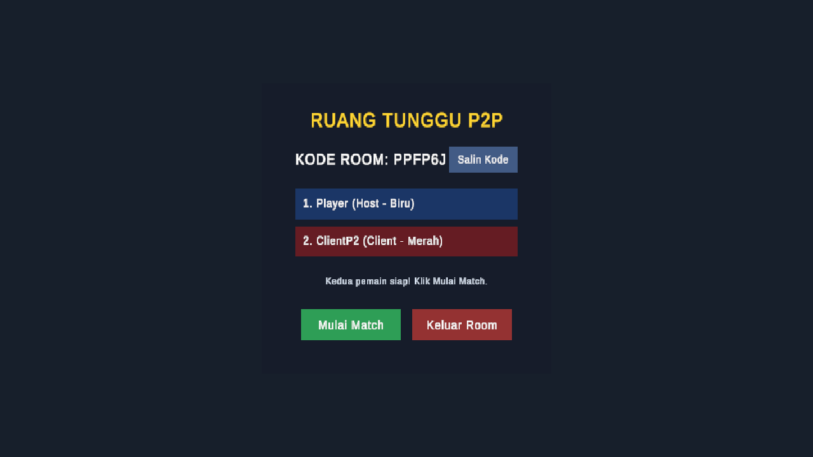
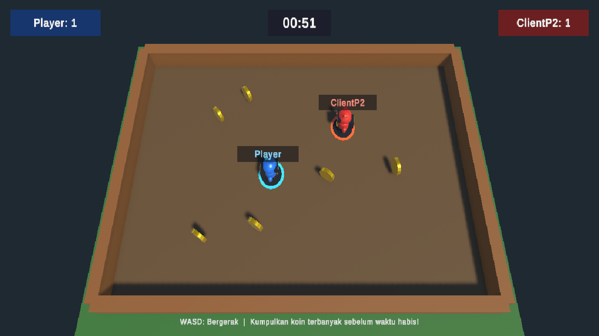

# LAPORAN TUGAS AKHIR
**PRAKTIKUM PEMROGRAMAN GAME BERBASIS JARINGAN**

**Oleh:**  
Nama Lengkap  
NRP.  

**PROGRAM STUDI SARJANA TERAPAN TEKNOLOGI GAME**  
**JURUSAN TEKNOLOGI MULTIMEDIA KREATIF**  
**POLITEKNIK ELEKTRONIKA NEGERI SURABAYA**  
**2026**

---

## Judul Game
**Coin Rush 2P** *(Dokumen 3 — Fase 3: Sistem Lobi, Multiplayer Peer-to-Peer & Kesiapan Build)*

## Ringkasan
Pada fase ketiga, gim **Coin Rush 2P** dilengkapi arsitektur jaringan *peer-to-peer* (*Host-Client*) dengan dua fitur utama:
1. **Sistem Lobi & Koneksi Kode Room (Unity Relay):** Pemain Host membuat ruang tunggu dan memperoleh Kode Room 6 karakter agar Player 2 dapat bergabung tanpa pengaturan IP atau router.
2. **Sinkronisasi Pertandingan Otoritatif (`Netcode for GameObjects`):** Host mengelola spawn pemain/koin, validasi skor, serta batas waktu berbasis *server time*, sedangkan kontrol `WASD` tetap berjalan responsif pada masing-masing pemilik (`IsOwner`) hingga siap di-*build* ke `CoinRush2P.exe`.

## Pengendalian dan Mekanisme
- **Aturan Tombol:**
  - **Menu & Lobi (Mouse/UI):** Klik **Buat Room P2P (Host)** untuk membuat kode, isi **Kode Room** lalu klik **Gabung** untuk masuk sebagai Client, dan Host menekan **Mulai Match** setelah slot terisi 2/2.
  - **Arena Bermain (`WASD`):** Masing-masing pemain menggerakkan karakternya di perangkat sendiri memakai `W / A / S / D` (New Input System).
- **Cara Kerja & Mekanisme Jaringan:**
  1. `LobbySessionManager` melakukan login anonim Unity Services, membuat/menggabungkan sesi via `WithRelayNetwork()`, lalu menyinkronkan perpindahan scene ke `CoinRush` melalui `NetworkManager.SceneManager.LoadScene`.
  2. `NetworkMatchController` mem-spawn `NetworkPlayer` sesuai slot (`Player 1` biru / `Player 2` merah), memproses *pickup* koin hanya di Host (`IsServer`) agar bebas *desync*, menyebarkan skor lewat `NetworkVariable<int>`, serta menangani putus koneksi agar pemain tidak terjebak pada build `.exe`.

## Tangkapan Layar Tahapan Pembuatan



**Gambar 1. Ruang Tunggu Lobi P2P (`Lobby.unity`) dengan Kode Room Aktif.**  
Menunjukkan sesi *Host-Client* yang berhasil terhubung melalui Unity Relay (`KODE ROOM: PPFP6J`), menampilkan daftar kedua pemain (`Player (Host - Biru)` dan `ClientP2 (Client - Merah)`) serta tombol **Mulai Match** bagi Host.

## Tangkapan Layar Hasil



**Gambar 2. Hasil Pertandingan Multiplayer P2P pada Scene `CoinRush`.**  
Menunjukkan kedua pemain (`Player` biru dan `ClientP2` merah) telah di-*spawn* dan bergerak sinkron di atas arena, lengkap dengan pembaruan skor `NetworkVariable` pada HUD serta sinkronisasi koin secara *real-time*.

## Kode Program

### 1. `LobbySessionManager.cs` (Lobi Relay P2P: Buat Room, Gabung Kode & Mulai Match)
```csharp
using System;
using System.Threading.Tasks;
using Unity.Netcode;
using Unity.Services.Authentication;
using Unity.Services.Core;
using Unity.Services.Multiplayer;
using UnityEngine;
using UnityEngine.SceneManagement;

namespace CoinRush.Networking
{
    public class LobbySessionManager : MonoBehaviour
    {
        public static LobbySessionManager Instance { get; private set; }
        public const string GameplaySceneName = "CoinRush";

        [SerializeField] private int maxPlayers = 2;
        public ISession CurrentSession { get; private set; }
        public string LocalPlayerName { get; private set; } = "Player";

        public event Action SessionUpdated;
        public event Action<string> StatusMessageChanged;

        private void Awake()
        {
            if (Instance != null && Instance != this) { Destroy(gameObject); return; }
            Instance = this;
            DontDestroyOnLoad(gameObject);
        }

        public async Task<bool> CreateRelayRoomAsync(string playerName)
        {
            LocalPlayerName = string.IsNullOrWhiteSpace(playerName) ? "Player 1" : playerName.Trim();
            await EnsureSignedInAsync();

            var options = new SessionOptions
            {
                Name = $"CoinRush_{UnityEngine.Random.Range(1000, 9999)}",
                MaxPlayers = maxPlayers,
                IsPrivate = false
            }.WithRelayNetwork();

            CurrentSession = await MultiplayerService.Instance.CreateSessionAsync(options);
            CurrentSession.Changed += () => SessionUpdated?.Invoke();
            CurrentSession.PlayerJoined += _ => SessionUpdated?.Invoke();
            StatusMessageChanged?.Invoke($"Room dibuat! Kode: {CurrentSession.Code}");
            SessionUpdated?.Invoke();
            return true;
        }

        public async Task<bool> JoinRelayRoomByCodeAsync(string roomCode, string playerName)
        {
            LocalPlayerName = string.IsNullOrWhiteSpace(playerName) ? "Player 2" : playerName.Trim();
            await EnsureSignedInAsync();

            CurrentSession = await MultiplayerService.Instance.JoinSessionByCodeAsync(
                roomCode.Trim().ToUpperInvariant(),
                new JoinSessionOptions()
            );
            CurrentSession.Changed += () => SessionUpdated?.Invoke();
            SessionUpdated?.Invoke();
            return true;
        }

        public bool StartOnlineMatch()
        {
            NetworkManager nm = NetworkManager.Singleton;
            if (nm == null || !nm.IsHost) return false;
            nm.SceneManager.LoadScene(GameplaySceneName, LoadSceneMode.Single);
            return true;
        }

        private async Task EnsureSignedInAsync()
        {
            if (UnityServices.State == ServicesInitializationState.Uninitialized)
                await UnityServices.InitializeAsync();
            if (!AuthenticationService.Instance.IsSignedIn)
                await AuthenticationService.Instance.SignInAnonymouslyAsync();
        }
    }
}
```

### 2. `NetworkMatchController.cs` (Sinkronisasi Pertandingan P2P Host-Client)
```csharp
using System.Collections;
using System.Collections.Generic;
using Unity.Collections;
using Unity.Netcode;
using UnityEngine;
using UnityEngine.SceneManagement;
using CoinRush.Audio;
using CoinRush.Core;
using CoinRush.Gameplay;
using CoinRush.UI;

namespace CoinRush.Networking
{
    public class NetworkMatchController : NetworkBehaviour
    {
        public static NetworkMatchController Instance { get; private set; }

        [SerializeField] private float roundDuration = 60f;
        [SerializeField] private NetworkPlayer networkPlayerPrefab;
        [SerializeField] private CoinSpawner coinSpawner;
        [SerializeField] private GameHUD hud;

        public readonly NetworkVariable<int> P1Score = new NetworkVariable<int>(0);
        public readonly NetworkVariable<int> P2Score = new NetworkVariable<int>(0);
        public readonly NetworkVariable<double> MatchEndServerTime = new NetworkVariable<double>(0d);
        public readonly NetworkVariable<int> MatchStateValue = new NetworkVariable<int>((int)MatchState.Countdown);

        private readonly List<NetworkPlayer> _spawnedPlayers = new List<NetworkPlayer>();
        private bool _matchStarted;

        private void Awake() => Instance = this;

        public override void OnNetworkSpawn()
        {
            P1Score.OnValueChanged += (_, __) => hud?.UpdateScores(P1Score.Value, P2Score.Value, "Player 1", "Player 2");
            P2Score.OnValueChanged += (_, __) => hud?.UpdateScores(P1Score.Value, P2Score.Value, "Player 1", "Player 2");

            if (IsServer)
            {
                NetworkManager.SceneManager.OnLoadEventCompleted += HandleSceneLoadCompleted;
                StartCoroutine(WaitForSceneSyncFallbackRoutine());
            }
        }

        private void Update()
        {
            if (IsSpawned && MatchStateValue.Value == (int)MatchState.Playing && NetworkManager != null)
            {
                float rem = Mathf.Max(0f, (float)(MatchEndServerTime.Value - NetworkManager.ServerTime.Time));
                hud?.UpdateTimer(rem);
            }
        }

        public void ServerNotifyCoinCollected(int playerIndex, int amount, Vector3 worldPosition)
        {
            if (!IsServer || MatchStateValue.Value != (int)MatchState.Playing) return;
            if (playerIndex == 0) P1Score.Value += amount;
            else P2Score.Value += amount;
            PlayCoinPickupFxRpc(playerIndex);
        }

        [Rpc(SendTo.ClientsAndHost)]
        private void PlayCoinPickupFxRpc(int collectorSlot)
        {
            int localSlot = (NetworkManager.Singleton != null && NetworkManager.Singleton.IsHost) ? 0 : 1;
            SynthAudioManager.Instance?.PlayCoinPickup(collectorSlot == localSlot);
        }

        private void HandleSceneLoadCompleted(string sceneName, LoadSceneMode mode, List<ulong> done, List<ulong> timeout)
        {
            if (IsServer && sceneName == LobbySessionManager.GameplaySceneName) TryBeginHostedMatch();
        }

        private IEnumerator WaitForSceneSyncFallbackRoutine()
        {
            yield return new WaitForSeconds(3.5f);
            TryBeginHostedMatch();
        }

        private void TryBeginHostedMatch()
        {
            if (!IsServer || _matchStarted) return;
            _matchStarted = true;

            foreach (ulong clientId in NetworkManager.ConnectedClientsIds)
            {
                int slot = clientId == NetworkManager.ServerClientId ? 0 : 1;
                Vector3 pos = slot == 0 ? new Vector3(-4.5f, 0.55f, 0f) : new Vector3(4.5f, 0.55f, 0f);
                NetworkPlayer np = Instantiate(networkPlayerPrefab, pos, Quaternion.identity);
                np.NetworkObject.SpawnAsPlayerObject(clientId, true);
                np.ServerConfigure(slot, slot == 0 ? "Player 1" : "Player 2");
                np.ServerSetControlsEnabled(true);
                _spawnedPlayers.Add(np);
            }

            MatchEndServerTime.Value = NetworkManager.ServerTime.Time + roundDuration;
            MatchStateValue.Value = (int)MatchState.Playing;
            coinSpawner?.BeginSpawning(3);
        }
    }
}
```
